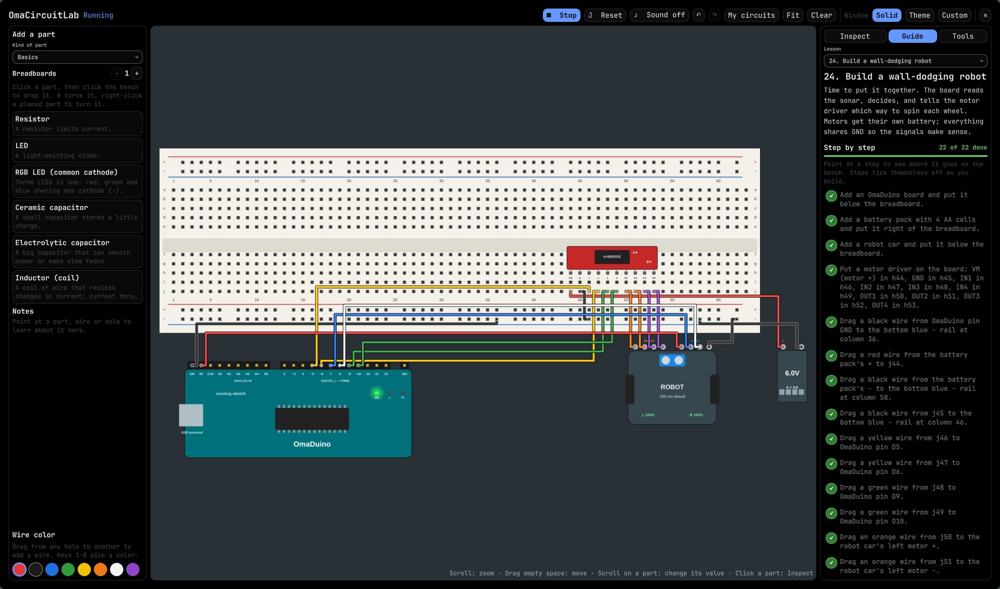
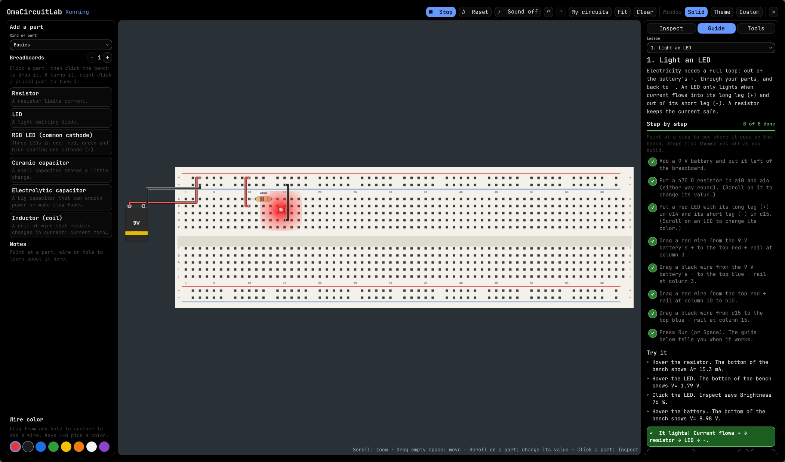
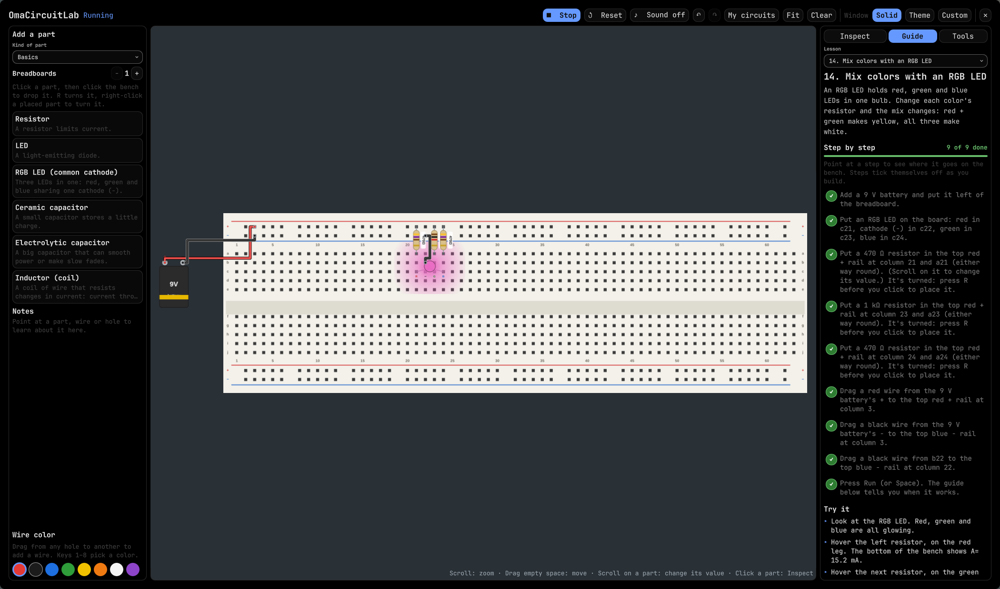
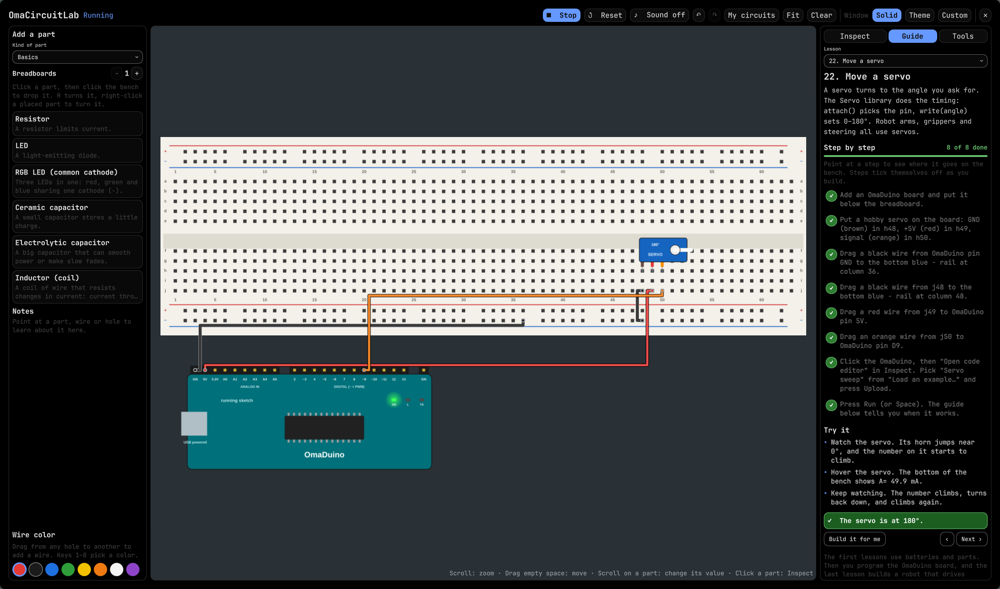
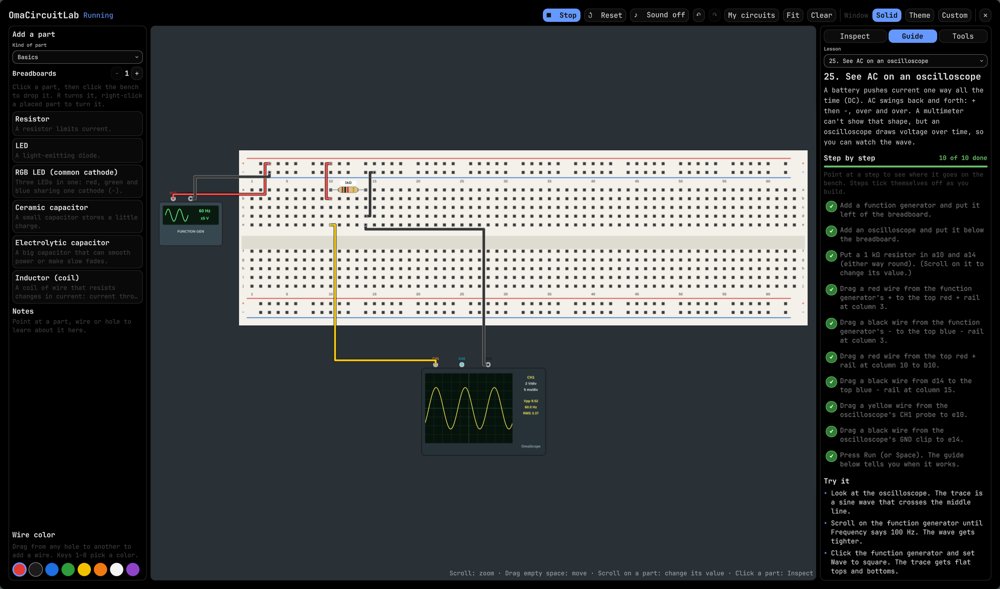
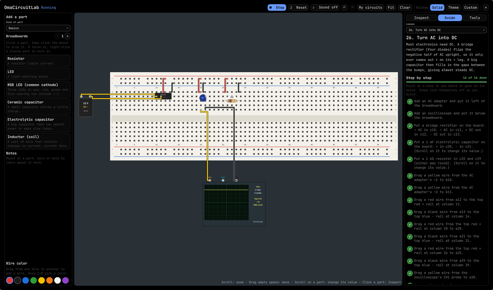
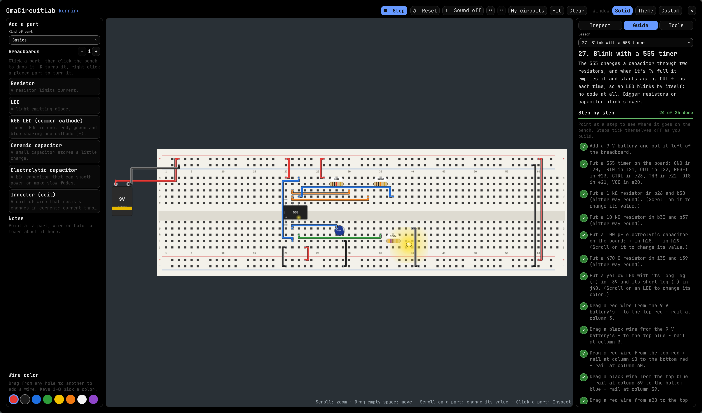

# OmaCircuitLab

A breadboard circuit simulator for learning electronics on Omarchy. Drop parts onto a full-size breadboard, wire them with neat square jumpers, press **Run**, and watch LEDs light, meters read and motors spin. Hover anything for a plain-language explanation, and follow the **Learner's Guide** from a first LED to driving a motor.



## Parts

46 parts in nine groups:

- **Power:** 9 V battery, AA battery pack (2–4 cells), adjustable bench supply (0–15 V with current limit), 7805 5 V regulator, fuse
- **Basics:** resistors (E12 values with correct color bands), LEDs in six colors, RGB LED, ceramic and electrolytic capacitors, inductor
- **Inputs & switches:** push button, slide switch, potentiometer, tilt switch
- **Sensors:** light sensor (LDR), thermistor, TMP36 temperature probe, photodiode
- **Diodes & transistors:** diode, zener, Schottky, NPN and PNP transistors, N-MOSFET, 555 timer, LM358 op-amp
- **Outputs & motion:** buzzer (with optional sound), DC motor, 7-segment display, relay, IR LED
- **AC power & signals:** function generator, 12 V AC adapter, transformer, bridge rectifier
- **Microcontroller & robotics:** OmaDuino, OmaNano and OmaTiny boards you program in Arduino-style code, hobby servo, HC-SR04 distance sensor, H-bridge motor driver, robot car with its own arena
- **Meters:** multimeter (volts, amps, ohms), clamp meter, two-channel oscilloscope

## Lessons

The **Guide** tab has 31 lessons, from lighting a first LED to building a wall-dodging robot, seeing AC on an oscilloscope, turning AC into DC, a 555 blinker, a relay, and programming the OmaNano and OmaTiny. Each lesson lists step-by-step build instructions with exact holes. Steps tick off as your bench matches, and the next step's holes glow on the board. **Build it for me** places the whole circuit. "Try it" steps then suggest experiments.

| | |
|---|---|
|  |  |
|  |  |
|  |  |

## Using it

Open **OmaCircuitLab** from the app menu.

| Do this | How |
|---|---|
| Add a part | Pick a kind of part, click a part, click the bench |
| Turn a part | `R`, or right-click it |
| Add a wire | Drag from one hole to another |
| Recolor a wire | Select it, click a color (or press `1`–`8` before drawing) |
| Move a wire end | Select the wire, drag one of its blue rings |
| Run / stop | `Space` |
| Press a button | Click and hold it while running |
| Flip a switch / change meter mode | Click it |
| Turn a knob, change light or temperature | Scroll on the part |
| Zoom / move the view | Scroll on empty space / drag empty space |
| Undo / redo | `Ctrl+Z` / `Ctrl+Shift+Z` |
| Program a board | Click it, then **Open code editor** in Inspect, pick an example or write your own, and press Upload |
| Save a circuit by name | **My circuits** |
| Close | `Esc` (your bench saves itself) |

## Easy to see on any theme

The window opens **Solid**: OmaCircuitLab asks Hyprland to draw its own window fully opaque, so a see-through dark theme never bleeds into the circuit. The toolbar's **Window** buttons switch between Solid, **Theme** (normal Omarchy transparency) and **Custom** (your own opacity). The breadboard itself is always light with outlined parts and wires.

## Light on your PC

Nothing runs while the window is closed: the shell only loads OmaCircuitLab when you open it. While open, the circuit solver runs on its own thread, only when something changes. Circuits that change over time (capacitors, motors, AC, programmed boards) step only while the window is open and running. Sound is off until you turn it on.

## Install

```
omarchy plugin add https://github.com/Dankestrick/OmaCircuitLab --enable
omarchy-shell shell toggle io.github.dankestrick.omacircuitlab
```

The first time it opens, OmaCircuitLab adds its own entry to the app menu, so after that you can open it from the launcher. It only creates that file when it is missing and never overwrites one.

OmaCircuitLab uses no network and never asks for root. The only optional dependency is `qt6-multimedia`,. Install that package to hear the buzzer. Without it, everything else works and the buzzer stays silent.

## Files it writes

| File | What |
|---|---|
| `~/.local/share/omacircuitlab.json` | Your current bench and settings (autosave) |
| `~/.local/share/omacircuitlab-projects.json` | Circuits you saved under a name in **My circuits** |
| `~/.local/share/applications/omacircuitlab.desktop` | The app menu entry |

## Remove

```
omarchy plugin remove io.github.dankestrick.omacircuitlab
rm -f ~/.local/share/applications/omacircuitlab.desktop
```

To also delete your saved benches and circuits:

```
rm -f ~/.local/share/omacircuitlab.json ~/.local/share/omacircuitlab-projects.json
```

## Development

`scripts/dev-install.sh` copies the checkout into `~/.config/omarchy/plugins/` and adds the app menu entry. Run the tests with `for t in tests/*.test.js; do node "$t" || break; done`. After any change to `qml/lib/Engine.js`, `Catalog.js`, `Mcu.js` or `EngineWorker.js`, run `python3 scripts/build-worker.py` and commit the regenerated `qml/lib/worker/*.mjs`.

## License

MIT
